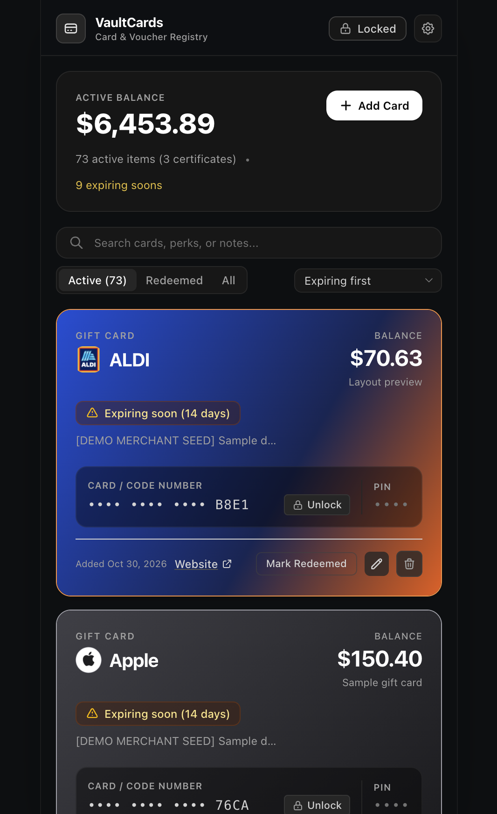
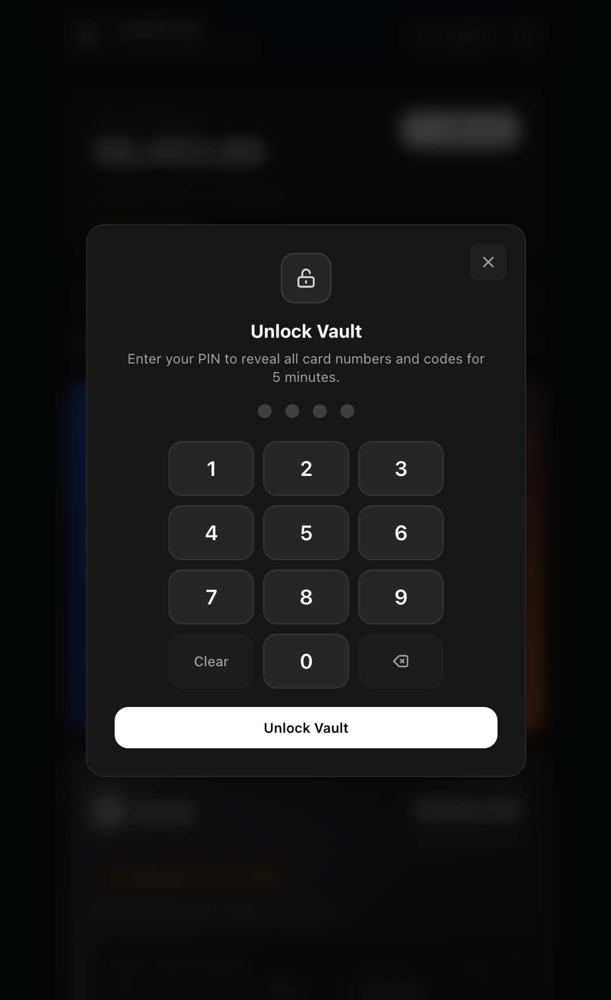
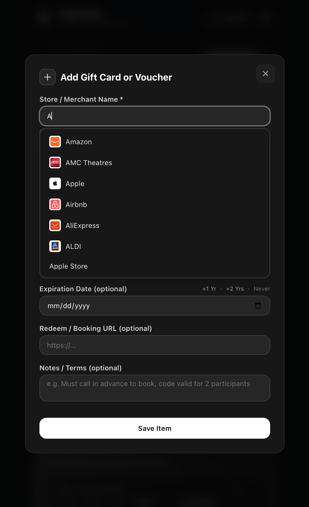
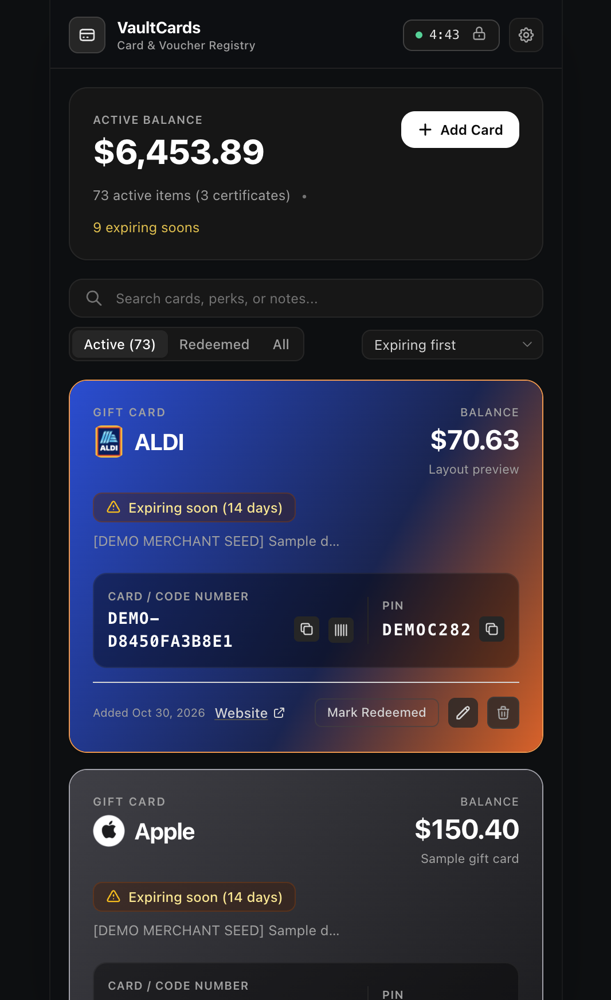
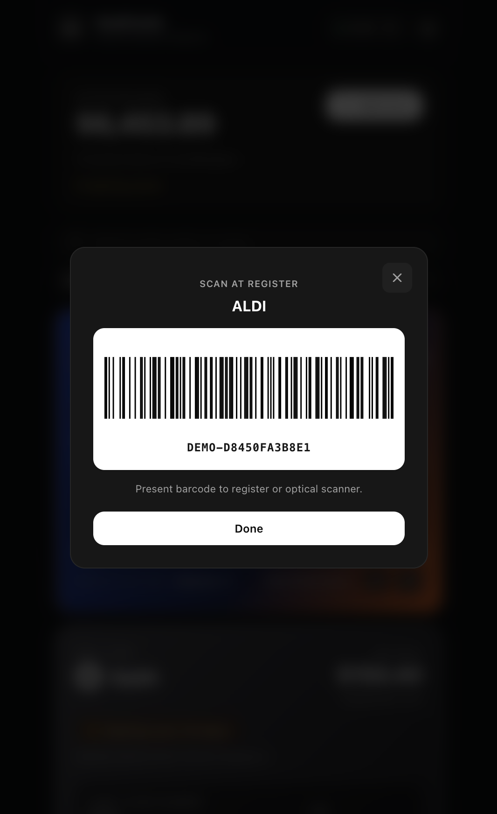

# VaultCards

A locally hosted gift-card and voucher wallet. Track balances, expiration dates, redemption status, notes, and booking links; search and sort your collection; and view barcodes when you need them.

Merchant autocomplete recognizes common brand-name variations and names already in your collection. Cards use bundled merchant logos and automatically selected brand-inspired colors, with a consistent fallback for other merchants.

Your collection is stored locally in SQLite. Card numbers and PINs are encrypted in the database. Unlike cloud wallets, VaultCards does not require an account or cloud sync; it is a better fit if you want to keep your collection on a device you control.

## Run locally

Requires Ruby 3.4.11 and SQLite.

```sh
bundle install
rails db:prepare
bin/dev
```

Open [http://localhost:3000](http://localhost:3000). A newly seeded development database uses unlock PIN `1234`; change it in Security Settings. To create a demo card for every built-in merchant:

```sh
rails runner -e development script/seed_demo_gift_cards.rb
```

Run tests with `rails test`.

## Offline note

The app's runtime uses local assets, its local SQLite database, and its own local autocomplete endpoint; it does not depend on remote services. Internet access may be needed to install Ruby dependencies during setup. Booking links are optional links that you choose to open.

## Screenshots

#### Wallet overview
##### Card collection, balances, expiration dates, and brand styling.


##### PIN to unlock card info


---

#### Autocomplete
##### Suggestions with bundled logos as a merchant name is entered.


---

#### Card details
##### A card's stored details and barcode view.



